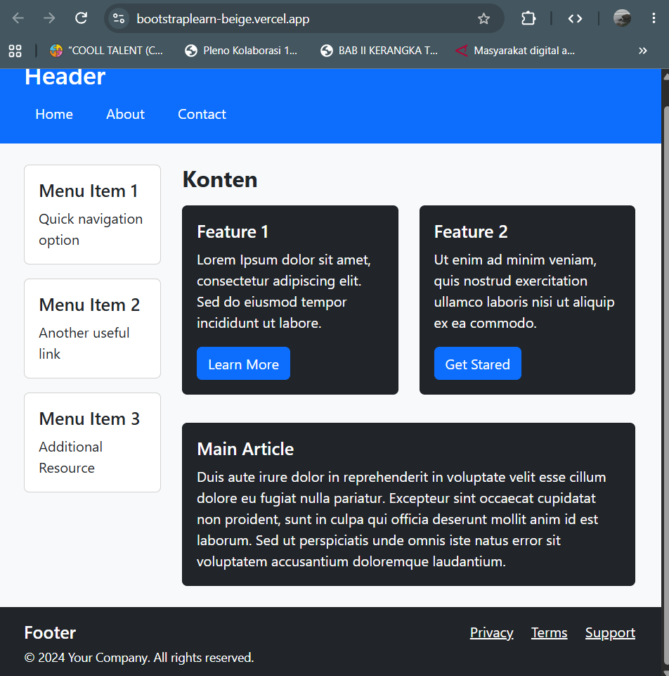
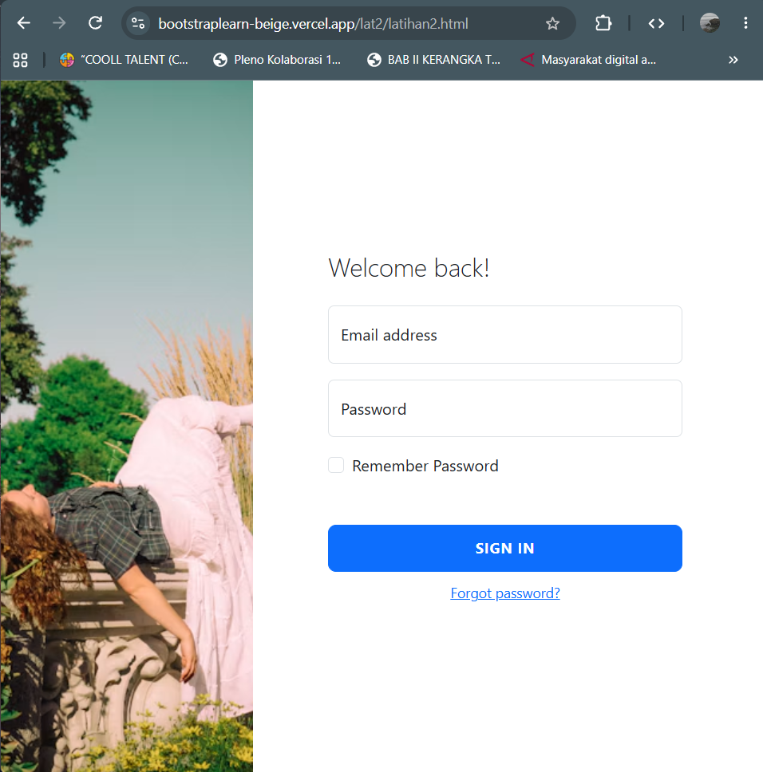
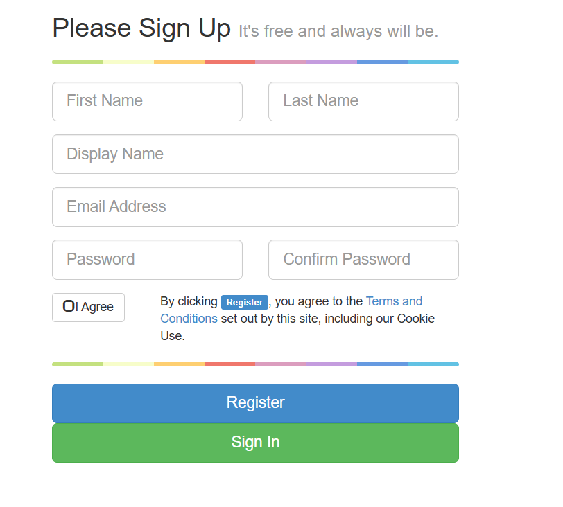

# Dokumentasi Latihan Bootstrap

Pada dokumentasi ini, saya membuat 3 website dengan bootstrap sebagai latihan. 

Nama website: https://bootstraplearn-beige.vercel.app/

---

### Identitas
Nama: Benedictus Imanuel Wicaksono  
NRP: 5025251039

## Soal 1

**Membuat struktur layout halaman web sederhana yang responsif menggunakan framework Bootstrap 5, terdiri dari header, sidebar navigasi, konten utama, dan footer.**

### Penyelesaian
https://bootstraplearn-beige.vercel.app/  
  

**Fitur:**
* **Header Navigasi:** Menampilkan judul halaman beserta tombol navigasi utama (Home, About, Contact).
* **Sidebar Menggunakan Card:** Menyediakan menu samping berbasis komponen Card Bootstrap untuk navigasi cepat.
* **Layout Grid Responsif:** Konten terbagi menjadi dua kolom utama (Sidebar 3 kolom dan Konten Utama 9 kolom) yang secara otomatis menyesuaikan tampilan pada berbagai ukuran layar.
* **Kartu Fitur & Artikel Utama:** Menggunakan komponen Card dengan tema gelap (`bg-dark text-white`) untuk menonjolkan fitur aplikasi dan artikel utama.
* **Footer Informasi:** Bagian bawah halaman yang memuat hak cipta serta tautan navigasi sekunder (Privacy, Terms, Support).

**Langkah-langkah:**
1. Menyiapkan berkas HTML dasar dan mengintegrasikan pustaka Bootstrap 5 melalui CDN CSS di bagian `<head>` serta CDN JS di bagian sebelum penutup `</body>`.
2. Membuat bagian `<header>` berlatar biru (`bg-primary`), memuat judul web serta tiga tombol navigasi.
3. Menyusun tata letak utama menggunakan elemen `
` dan `
`.
4. Membuat kolom kiri (`<aside class="col-md-3">`) yang berisi tiga komponen Card sebagai menu samping/sidebar.
5. Membuat kolom kanan (`<main class="col-md-9">`) untuk konten utama, yang di dalamnya terdapat *nested grid* (`row` dengan 2 kolom `col-md-6`) untuk menampilkan dua fitur utama, serta satu Card artikel utama di bawahnya.
6. Menambahkan bagian `<footer>` di bawah dengan warna latar gelap (`bg-dark`) dan tata letak `d-flex justify-content-between` untuk merapikan posisi teks hak cipta dan link pendukung.

**Cara Kerja:**
* **Sistem Grid Bootstrap:** Bootstrap membagi layar menjadi 12 kolom. Atribut `col-md-3` pada sidebar dan `col-md-9` pada konten utama berarti pada layar laptop/desktop (ukuran `md` ke atas), sidebar mengambil 3 kolom dan konten mengambil 9 kolom. Pada layar smartphone (di bawah `md`), kedua kolom ini otomatis menumpuk vertikal menjadi 100% lebar layar.
* **Utility Classes:** Kelas-kelas bawaan Bootstrap seperti `bg-primary`, `bg-dark`, `text-white`, `mb-3` (margin bawah), `p-3` (padding), dan `h-100` (tinggi penuh 100%) digunakan untuk mengatur gaya visual dan jarak antar elemen secara praktis tanpa perlu menulis CSS manual.

---

## Soal 2

**Membuat tampilan halaman login modern dengan konsep split-screen (latar gambar di sisi kiri dan form login di sisi kanan) menggunakan Bootstrap 5 dan CSS kustom.**

### Penyelesaian
https://bootstraplearn-beige.vercel.app/lat2/latihan2.html  
  

**Fitur:**
* **Layout Split-Screen Modern:** Tampilan terbagi dua antara gambar latar (*background image*) dan form login.
* **Floating Labels Input:** Kolom input email dan kata sandi menggunakan efek label melayang bawaan Bootstrap 5 saat diklik atau diisi.
* **Responsif Sesuai Ukuran Layar:** Gambar latar di sisi kiri otomatis disembunyikan pada layar ponsel kecil agar form login dapat tampil penuh dan nyaman dibaca.
* **Gaya Visual Kustom:** Penyesuaian tinggi halaman penuh (`100vh`), tata letak gambar penuh (*cover*), serta tombol login yang besar dan rapi.

**Langkah-langkah:**
1. Membuat struktur HTML dasar dan menghubungkan CDN Bootstrap 5 serta berkas CSS kustom (`latihan2.css`).
2. Menggunakan `container-fluid` dengan `row g-0` (tanpa jarak/gutters) agar layout memenuhi seluruh lebar layar.
3. Membagi layar menjadi dua kolom:
   - Kolom kiri (`
`) khusus untuk gambar latar.
   - Kolom kanan (`
`) untuk area form login.
4. Menambahkan komponen `form-floating` pada input Email dan Password agar label berada di dalam input dan bergerak ke atas saat input terisi.
5. Menambahkan pilihan "Remember Password", tombol submit "Sign in", serta tautan "Forgot password?".
6. Menuliskan CSS di file `latihan2.css` untuk mengatur tinggi area login (`min-height: 100vh`), mengambil gambar dari Unsplash, dan mengatur tata letak tombol login.

**Cara Kerja:**
* **Pengaturan Latar Belakang (`latihan2.css`):** Kelas `.login` diberi `min-height: 100vh` agar area login selalu memenuhi tinggi layar peramban. Kelas `.bg-image` mengambil gambar lewat URL Unsplash dan menerapkan `background-size: cover` agar gambar selalu menutupi seluruh area kolom tanpa terdistorsi.
* **Sembunyi/Tampil Responsif (`d-none d-md-flex`):** Kelas `d-none` menyembunyikan kolom gambar pada layar perangkat kecil (HP). Namun, berkat kelas `d-md-flex`, begitu ukuran layar mencapai breakpoint medium (tablet/desktop), gambar latar akan otomatis muncul sebagai elemen flexbox.
* **Interactive Floating Labels:** Kelas `form-floating` dari Bootstrap secara otomatis mengatur posisi `<label>` di dalam elemen `<input>`. Saat pengguna mengeklik atau mengetik di kolom tersebut, CSS bawaan Bootstrap melakukan animasi pergeseran label ke posisi atas.

---

## Soal 3

**Membuat form pendaftaran akun baru yang dilengkapi tombol persetujuan kustom (Button-Checkbox berbasis JQuery/Bootstrap) serta modal penjelasan syarat & ketentuan.**

### Penyelesaian
https://bootstraplearn-beige.vercel.app/lat3/latihan3.html  
  

**Fitur:**
* **Garis Pembatas Pelangi (Colorgraph):** Garis hiasan berwarna-warni yang dibuat murni menggunakan gradien CSS (`linear-gradient`).
* **Interactive Button-Checkbox:** Mengubah kotak checkbox standar HTML menjadi tombol "I Agree" yang interaktif lengkap dengan ikon status (centang / tidak dicentang).
* **Modal Terms & Conditions:** Jendela pop-up (Modal) yang muncul saat pengguna mengeklik tautan "Terms and Conditions".
* **Form Grid Multi-Kolom:** Kolom nama (First & Last Name) serta kata sandi (Password & Confirm Password) tertata sejajar secara rapi.

**Langkah-langkah:**
1. Menyusun dokumen HTML dan memuat CSS `latihan3.css`, Bootstrap 3 CSS, jQuery, dan Bootstrap 3 JS secara berurutan pada bagian `<head>`.
2. Merancang form registrasi menggunakan sistem grid Bootstrap 3 (`col-xs-*`, `col-sm-*`, `col-md-*`).
3. Membuat elemen khusus `.button-checkbox` yang membungkus tombol `<button>` bertuliskan "I Agree" dan elemen `<input type="checkbox">` yang disembunyikan (`class="hidden"`).
4. Menambahkan tautan pemicu modal (`data-toggle="modal" data-target="#t_and_c_m"`) serta komponen jendela modal HTML (`#t_and_c_m`) berisi teks syarat dan ketentuan di bagian bawah form.
5. Menuliskan gaya gradien warna pada kelas `.colorgraph` di file `latihan3.css`.
6. Menuliskan skrip jQuery (`latihan3.js`) untuk menangani interaksi klik pada tombol checkbox kustom dan memperbarui tampilan ikon serta warna tombol.

**Cara Kerja:**
* **Garis Gradien CSS (`.colorgraph`):** Memanfaatkan properti `linear-gradient(to right, ...)` pada CSS untuk membagi beberapa warna secara tegas, menciptakan garis dekoratif pembatas antar bagian form.
* **Kustomisasi Checkbox dengan jQuery (`latihan3.js`):**
  - Saat halaman dimuat (`init()`), skrip menyisipkan elemen ikon `<i>` dengan kelas `state-icon` ke dalam tombol.
  - Ketika tombol di-klik, *event listener* `$button.on('click')` akan mengubah status centang pada input checkbox tersembunyi (`$checkbox.prop('checked', ...)`).
  - Fungsi `updateDisplay()` membaca status checkbox tersebut. Jika dicentang (`isChecked = true`), warna tombol berubah menjadi warna tema (`btn-info`), tombol diberi status aktif, dan ikon berganti menjadi `glyphicon-check`. Jika tidak dicentang, tombol kembali berpenampilan netral (`btn-default`) dengan ikon `glyphicon-unchecked`.
* **Pop-Up Modal Bootstrap:** Jendela modal dipicu melalui atribut data Bootstrap (`data-toggle="modal"` dan `data-target="#t_and_c_m"`). Saat tautan diklik, JavaScript bawaan Bootstrap akan menampilkan dialog modal tanpa memerlukan penyegaran halaman (*page refresh*).